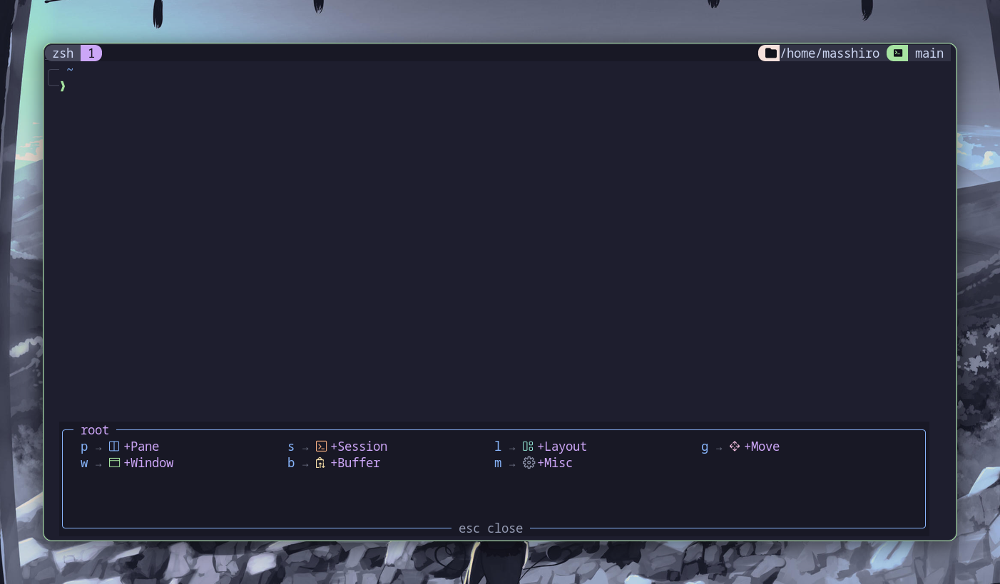

# tmux-which-key

A which-key popup for tmux. Press `prefix + Space` and see every key you have bound, grouped and labeled, then press one to run it.

> Fork of [Nucc/tmux-which-key](https://github.com/Nucc/tmux-which-key). Upstream shows a static
> JSON menu; this fork reads your live tmux bindings, so the menu always matches your `tmux.conf`.




## Features

- **Your real bindings** - built from the running tmux, grouped into pane, window, session, buffer, layout and misc
- **Git group** - `g` for status, diff, log, add, commit, push, pull, stash and lazygit (if installed)
- **Your own keys in tmux.conf** - add groups and keys that run shell commands, tmux commands, popups or scripts
- **Compact popup** - sized to the menu, with Nerd Font icons and a swappable theme

## Requirements

- tmux 3.4+ and `jq`
- A true color terminal, and a [Nerd Font](https://www.nerdfonts.com/) for the icons

## Installation

With [TPM](https://github.com/tmux-plugins/tpm), add this and press `prefix + I`:

```tmux
set -g @plugin 'TheMasshiro/tmux-which-key'
```

Manually:

```bash
git clone https://github.com/TheMasshiro/tmux-which-key.git ~/.tmux/plugins/tmux-which-key
echo 'run-shell ~/.tmux/plugins/tmux-which-key/which-key.tmux' >> ~/.tmux.conf
```

With Nix flakes, add the input `github:TheMasshiro/tmux-which-key` and put
`inputs.tmux-which-key.packages.${pkgs.system}.default` in `programs.tmux.plugins`.

## Usage

Press `prefix + Space`, then a key. `+Name` entries open a group; `esc` and `⌫` go back or close.
Keys inside a group are the real tmux keys: `prefix Space p |` does what `prefix |` does.

## Options

| Option | Default | Description |
|--------|---------|-------------|
| `@which-key-trigger` | `Space` | Key after prefix that opens the menu |
| `@which-key-icons` | `on` | `off` hides the icons |
| `@which-key-theme` | `catppuccin-mocha` | Theme name in `themes/`, or a path |
| `@which-key-popup-width` / `-height` | fits the menu | Popup size |
| `@which-key-popup-x` / `-y` | `C` / bottom | Popup position |
| `@which-key-extras` | `configs/extras.json` | Extra groups file (the git group), or `none` |
| `@which-key-config` | none | Static JSON menu that replaces the live one (example: `configs/default.json`) |

## Your Own Keys

Add, rename or remove entries in `tmux.conf`:

```tmux
set -g @which-key-group-o 'Tools'                      # new group on o
set -g @which-key-o-h     'Htop : popup:htop'          # entry h in group o
set -g @which-key-g-t     'Tig : popup:tig'            # add to the git group
set -g @which-key-root-f  'Files : popup:yazi'         # top-level key
set -g @which-key-g-p     none                         # remove an entry
set -g @which-key-group-l none                         # remove a group
```

The part after ` : ` is typed into the pane and run. Prefix it with `tmux:` for a tmux command,
`popup:` for a popup in the pane's directory, or `run:` for a background shell command.

## Themes

Colors, icons, border characters and hint text live in [themes/catppuccin-mocha.sh](themes/catppuccin-mocha.sh).
Copy it, edit it, and set `@which-key-theme` to the copy's path.

## Labels

Known tmux commands get plain labels ("Split vertical", "Kill pane"). For anything else,
`bind -N "note"` (24 characters max) sets the label. A `switch-client -T <table>` binding becomes a
group for that key table; when its key is taken (like `g` by git) it moves to a free one.

## License

MIT
